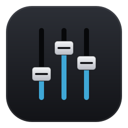

# OpenMixer

<p align="center">
  
</p>

A mixer for **Audient iD** audio interfaces on Linux, written in Rust with [gpui](https://crates.io/crates/gpui).
It drives the interface's internal DSP the same way the official iD software does:
Main / Cue A / Cue B mixes, pan, mute/solo, stereo links, a monitor section
(Dim, Cut, Mono, Ø), headphone level, output routing and level meters.

## Supported models

| Model | USB | Status |
|---|---|---|
| iD14 MKII | 2708:0008 | protocol verified: all controls are written, and the saved state is pushed on connect |
| iD24 | 2708:000d | protocol verified (no routing in the UI yet) |
| iD14 | 2708:0002 | not verified: nothing is sent on connect, only your manual changes are written |
| iD44 / iD44 MKII | 2708:0005 / 000b | read-only: the mixer layout is not confirmed yet |

Writing to the wrong matrix cell can mute an interface until it is unplugged,
so unverified models are handled cautiously.

## No kernel driver needed

These interfaces are *USB Audio Class 2* compliant, so `snd-usb-audio` already
handles audio. OpenMixer talks to the mixer through the interface's spare DFU
interface, because the firmware accepts mixer requests on any of its
interfaces. It **never** detaches `snd-usb-audio`, so audio keeps playing
while the mixer runs.

> Tools that detach interface 0 (the "exclusive" mode of MixiD/BiD) make the
> sound card disappear until the interface is replugged.

## Installation

```sh
# USB access for the logged-in user (once)
sudo install -m644 packaging/70-openmixer-audient.rules /etc/udev/rules.d/
sudo udevadm control --reload && sudo udevadm trigger --attr-match=idVendor=2708

cargo build --release

# icon + application launcher for the current user
packaging/install-desktop.sh
```

Commands:

- `openmixer`: graphical mixer. Closing the window keeps it running in the system tray;
  left-click the tray icon to reopen it, or use its menu to quit
- `openmixer --preview`: preview the mixer without an interface connected
- `openmixer probe`: read-only. Prints the model, monitor volume and meters
- `openmixer fix-balance [--remove]`: left/right balance fix (see below)
- `openmixer udev-rule`: prints the udev rule and how to install it

Mixer state is saved in `~/.config/openmixer/<model>.toml`.

## Known Linux issues

**Sound only on the left.** There are two causes:
1. The interface's DSP matrix keeps its previous mix, and no Linux tool sets
   it. On connect, OpenMixer writes a clean mix: DAW 1 left, DAW 2 right,
   at 0 dB.
2. The firmware ignores the left half of the *hardware* volume that PipeWire
   uses, which can leave the right side at -127 dB. OpenMixer resets both
   monitor outputs to 0 dB on connect. The **L/R balance fix** button (or
   `openmixer fix-balance`) switches Audient outputs to software volume in
   WirePlumber, so this does not happen again.

**Microphone not detected.** PipeWire's "HiFi" profile splits the interface
into mono sources, `Mic1` and `Mic2`. Set the default source to the one that
matches the input your microphone is plugged into. OpenMixer's meters show
where the signal arrives. Condenser microphones also need **48V** phantom
power.

## Building

gpui 0.2.2 depends on `xattr 0.2.3`, which does not build with `libc` ≥ 0.2.190.
`Cargo.lock` pins `libc` to 0.2.188, so avoid a blanket `cargo update`.

The code forbids `unsafe` and denies `unwrap`, `expect` and `panic!`
(see `[lints]` in `Cargo.toml`).

## Credits

The protocol comes from the reverse-engineering work of
[MixiD](https://github.com/TheOnlyJoey/MixiD), [BiD](https://github.com/baakhoff/BiD)
and [Monix](https://github.com/sKuhLight/monix) (all MIT).
